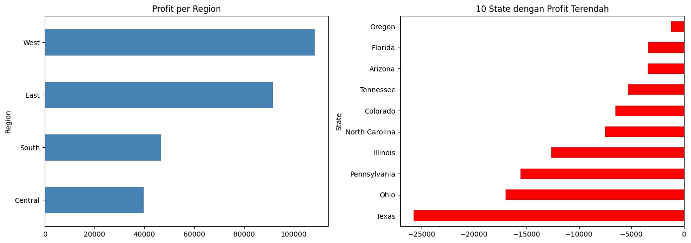
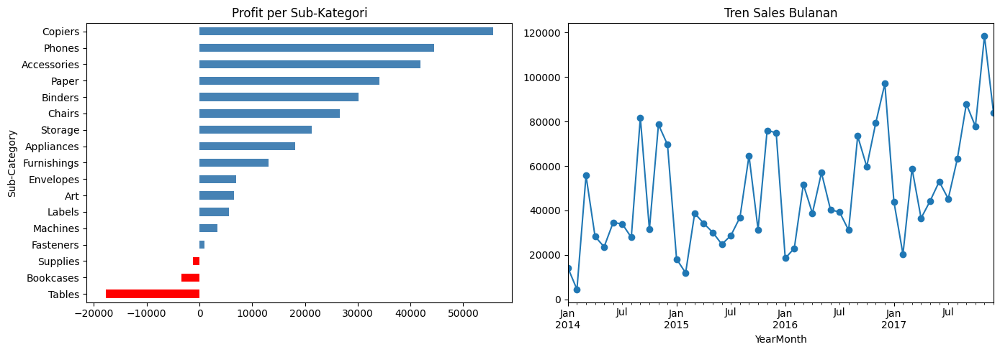

# Analisis Penjualan Superstore

## Latar Belakang
Analisis ini mencari faktor yang memengaruhi profit pada data
penjualan Superstore (2014-2017, 9.994 transaksi).

## Pertanyaan Bisnis
1. Kategori dan sub-kategori apa yang paling menguntungkan?
2. Mengapa Furniture margin-nya rendah?
3. Bagaimana pengaruh diskon terhadap profit?
4. Region dan state mana yang bermasalah?

## Temuan Utama
1. Furniture punya sales besar (742 ribu) tetapi margin hanya 2,49%,
   akibat kerugian di Tables dan Bookcases.
2. Tables untung 13,3 ribu pada diskon 0%, tetapi rugi di semua
   level diskon 20% ke atas.
3. Region East punya diskon Tables tertinggi (37,4%) dan kerugian
   Tables terbesar; West (diskon 20%) satu-satunya yang untung.
4. Central punya margin terendah (7,92%) dengan diskon rata-rata 24%.
5. Korelasi diskon dan profit negatif (-0,219).

## Rekomendasi
1. Batasi diskon Tables dan Bookcases maksimal sekitar 20%.
2. Samakan praktik diskon di East dan Central dengan West.
3. Tinjau kebijakan diskon di Texas, Ohio, Pennsylvania, Illinois.
4. Fokuskan promosi pada Copiers, Phones, dan Accessories.

## Visualisasi

## Tools
Python (pandas, matplotlib), Google Colab

## Catatan
Dataset: Superstore (Kaggle). Korelasi bukan berarti sebab-akibat;
diskon adalah faktor utama, tetapi faktor lain seperti biaya produk
dan campuran produk per region belum dianalisis.
